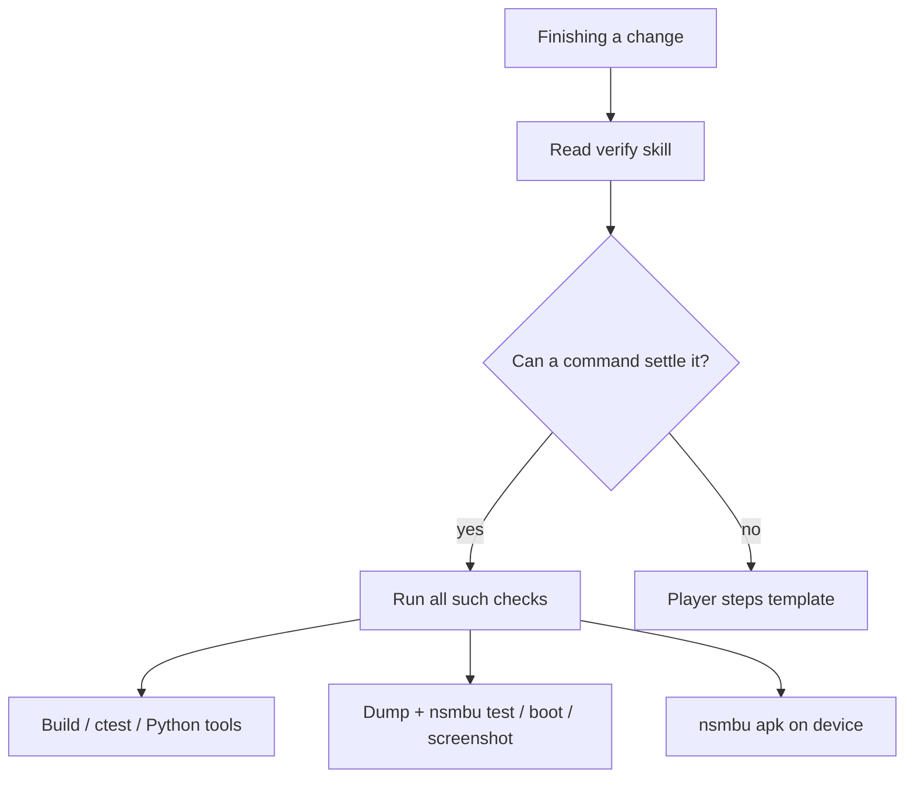

# Agent verification

How agents are expected to check work in this repo: policy, commands, CI mirrors, and gaps.

For day-to-day finish rules, read the `verify` skill (`.agents/skills/verify/SKILL.md`) first.
This document is the full inventory behind that skill.

## Policy stack

Three layers apply on most changes.

**`AGENTS.md`** — Before finishing, read the `verify` skill.
Run every check a command, playtest, boot, or APK install can settle.
When someone must play through a level, end the turn with explicit player steps.

**Project skills** (`.agents/skills/`) — Routing table:

- **`verify`** — Default host (Linux + `usa-1.3.0`), Android APK when relevant, player-step template.
- **`nsmbu`** — Builds, dumps, playtests, benches, scripted boots, live look, replay.
- **`scenes`** — Short boots to map, course, or title (`references/` recipes).
- **`pre-release`** / **`release`** — Full `nsmbu test`, installer, tag workflow.
- **`decompile`** — Decomp workflow only (no compile-time proof in NSMBU).

**Docs** — `docs/automation.md`, `docs/cli.md`, `docs/env.md`, boot recipes, issue ↔ test mapping in automation.

### Decision rule (`verify` skill)

If a command can prove pass or fail in this turn, run it.
Examples: unit test, `nsmbu test`, scene boot, screenshot, `nsmbu apk`.

If someone must play a level, end with Host, Place, Actions, and Pass, and call that part unverified.



## Tier A — No game dump

These use placeholder guest code from `tools/recomp/stubgen.py`, not a `game/` tree.
CI runs them in `.github/workflows/linux.yml` (and related workflows).

### C++ unit tests (`ctest`)

Configure and build like Linux CI, then:

```bash
python3 tools/recomp/stubgen.py build/gen-stub
cmake -S . -B build/linux -G Ninja -DGEN_DIR="$PWD/build/gen-stub" …
cmake --build build/linux
ctest --test-dir build/linux --output-on-failure
```

The root `CMakeLists.txt` registers many tests: mods, input (`input_mapping`, issue #9), interpolation (`interp_picture`, `interp_joints`, `interp_pacing`), portable state, extract crypto, SDL host tests, Vulkan-only tests when enabled, and more.

**Shortcut:** `nsmbu build` for a warm debug link after runtime-only edits.
See the `nsmbu` skill for when `--recomp` is required.

### Python tool tests (Linux CI, after `ctest`)

- `tools/installer/test_setup.py` (includes issue #11 Windows paste test)
- `tools/recomp/test_builds.py`, `test_output.py`, `test_pool.py`
- `tools/android/test_apk_cli.py`
- `tools/lib/test_dev_game_icon.py`
- `tools/test_shaderprep.py`
- `python3 -m unittest discover -s tools/bench -p "test_*.py"`
- `python3 -m unittest discover -s tools/gametest -p "test_*.py"`

### Vulkan renderer smoke (no gameplay)

Under `xvfb-run` with validation env vars.
Several variants run in `linux.yml`: default barriers, sync negative control, conservative barriers, BC decode verify.

```bash
./build/linux/nsmbu --renderer-smoke
```

Logs must contain `[renderer smoke] PASS:` and must not show validation errors (exact greps are in the workflow).

### Mod and CLI lint

```bash
nsmbu lint
```

Builds modding TypeScript→Lua and runs stylua on examples.
`docs/cli.md` mentions `tsc --noEmit` for the CLI itself; that is not wired into the `verify` skill or CI as a single mandatory agent step.

### Scripted run comparison

Documented in `docs/automation.md`.
Not the same as playtests.

- `tools/gametest/run_scenario.sh` writes `status.txt` per logic step.
- `tools/gametest/compare.py` aligns two runs on a scene and diffs them.

Useful for comparing two builds without adding a new `PlayCase`.

### Git push hook

`.githooks/pre_push.py` (see `pre-release` skill) builds a clean tree or worktree and runs full `ctest`, `test_setup.py`, and `test_builds.py`.
It does **not** run `nsmbu test`.

## Tier B — Needs `game/` and a debug build

Default dump per `verify`: **`usa-1.3.0`**.
Use `nsmbu game --list` and `nsmbu game usa-1.3.0`.
Do not run bare `nsmbu game` (TUI).

### Playtests (canonical game regressions)

```bash
nsmbu test --list
nsmbu test [name…]
```

Cases run in parallel (default 2 jobs; override with `NSMBU_TEST_JOBS`).
Add cases under `tools/cli/src/playtest/cases/` and register in `cases/index.ts`.
Helpers live in `tools/cli/src/playtest/helpers.ts`.

Registered cases (run `--list` for summaries):

- `startup` — #6 boot with save
- `opening-cinematic`, `save-roundtrip`, `save-state`, `course-enter` — #14 Quick Save / map / high fps
- `course-enter-120` — #15 at 120 fps
- `map-shadow-120` — #20 at 120 fps
- `opened-course` — 0.6.1 course-open / leave-to-map
- `pose-direction-120`, `logic-rate-120` — interpolation / frame pacing
- `widescreen-map-ui`, `widescreen-title` — 21:9 UI

Each case uses `.tmp/playtest/<name>/` for save, control socket, log, and userdata (`NSMBU_USER_DIR` under that folder).

Playtests are **not** in GitHub CI (no game dump in CI).
Agents with a local dump are the main line for game regressions.
`pre-release` requires full `nsmbu test`.

Issue coverage outside playtests (see `docs/automation.md`):

- #9 multiplayer bindings — `ctest -R input_mapping`
- #11 Windows common-key paste — `tools/installer/test_setup.py`
- #7 choppy gameplay — no deterministic playtest; shader precompile and Vulkan smoke cover mitigations
- 0.6.2 mismatched color-target freeze — Vulkan renderer smoke (`mismatched_color_targets`)

### Short scene boots (`scenes` skill)

Recipes in `.agents/skills/scenes/references/*.md`.
Boot, poll `nsmbu wait` / `nsmbu status`, save `nsmbu screenshot .tmp/repro/…`.
Checks that must keep passing belong in a `PlayCase`, not a one-off boot.

### Live look (while writing a case)

`nsmbu open`, `status`, `press`, `stick`, `wait`, `screenshot`, `close`.
One game, one socket under `.tmp/agent/`.
`nsmbu test` refuses to start while the live agent is up.

### Scripted boots

`nsmbu scripted <name>` wraps `tools/run/scripted-run.sh` with `NSMBU_EXIT_AT_FRAME`, `NSMBU_DUMP_FRAMES`, `NSMBU_PRESS`, and related vars.
Frame PNGs land in `.tmp/<name>/`.
Flicker checks: `python3 tools/frames/flicker.py`.

### Record and replay

`nsmbu record` / `nsmbu replay` (and `--release` for measured course runs) for long pad timelines.
See `docs/automation.md`.

### Performance bench

```bash
nsmbu bench --list
nsmbu bench load-overworld
```

Visible window; trace under `.tmp/bench/…`.
Not a pass/fail regression harness like `nsmbu test`.

### Build and dump maintenance

| Situation | Command |
| --- | --- |
| Runtime-only C++ / Lua port | `nsmbu build` |
| Hooks / recomp / version switch | `nsmbu game <id> --recomp` then `nsmbu build` |
| Interp pose / camera | `interp_picture_test` (ctest) plus env flow in `docs/env.md`; playtest `pose-direction-120` |

### Special runtime checks

- `nsmbu crash` — host crash path / crash log (Debug build)
- `nsmbu wine` — Windows binary under Wine (heavy; CI has `windows.yml`)
- `nsmbu installer --no-open` — release-style Linux package (`pre-release`)

## Tier C — Android

From `verify`:

- `nsmbu apk` — build release-style setup APK (no game inside), install via adb
- `python3 tools/android/apk.py --list-devices`, `--device SERIAL` when multiple devices

CI `android` workflow: placeholder native build, Gradle release, `tools/release/guard.py`.
No on-device gameplay in CI.

**Gap:** touch controls and phone vibration are Android-only; `nsmbu test` does not cover them (`docs/platforms/android/implementation.md`).

## Tier D — Human only

Use the `verify` player-step block: Host, Place, Actions, Pass.
Label **unverified** until a person completes those steps.

Examples from docs:

- Full level play, feel, and sessions beyond what `input_mapping` ctest covers
- Issue #7 where no deterministic playtest exists
- Android touch UX

## Tier E — CI and release (not every local change)

| Workflow | What it proves |
| --- | --- |
| `linux.yml` | Stub build, ctest, Python suites, renderer smoke variants |
| `windows.yml` | Windows stub build, ctest, smoke under Wine/lavapipe |
| `android.yml` | Placeholder APK, legal guard |
| `release.yml` | Multi-platform release artifacts, signing, extra smokes |

The **ci-investigator** subagent is for explaining one failed PR check, not routine finish verification.

## Tier F — Review, not execution

When explicitly requested:

- **Bugbot** subagent — local diff review
- **Security Review** subagent
- User skill `misc/code-review`

These do not replace tests.

## Decomp (separate from the port)

The `decompile` skill writes C++ under `vendor/decomp`.
Decomp is not compiled in NSMBU builds.
Verification there is review and disassembly (`ppcdis.py`), not `ctest` or `nsmbu test`.
WWHD’s `vendor/ZeldaWWHDRecomp/tools/verify/` harness is upstream reference, not NSMBU agent workflow.

## Gaps and cleanup targets

**Strong today**

- Finish rule in `AGENTS.md` plus `verify` skill
- `nsmbu test` as canonical game regression API with docs in `automation.md`
- Rich Tier A mirror in `linux.yml` that agents can replay locally

**Fragmented or easy to miss**

- `verify` mentions unit tests generically but not `ctest`, Python discovers, `--renderer-smoke`, or `nsmbu lint`
- Playtests never run in CI; agents without `game/usa-1.3.0` cannot fully verify game changes
- Three short-check paths overlap: `scenes`, live look, `nsmbu scripted` — skill says lasting checks → playtest, nothing enforces it
- `pre_push` ≠ `verify` ≠ `pre-release` — different command subsets
- Android verify is install-shaped, not gameplay automation
- CLI TypeScript has no first-class “run before finish” step in `verify` (modding uses `nsmbu lint`)

**Backlog** — [shader-rebuild.md](../plans/shader-rebuild.md): in-game rebuild marker and setup Precompile wipe.

## Related docs

- [../automation.md](../automation.md) — playtests, scripted boots, gametest compare
- [../cli.md](../cli.md) — full `nsmbu` command list
- [../env.md](../env.md) — `NSMBU_*` variables and interpolation checks
