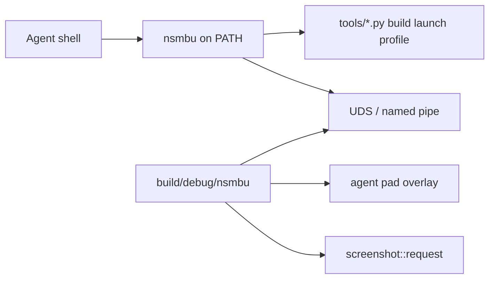

# `nsmbu` developer and agent CLI

## Goals

Ship a native TypeScript CLI under `tools/cli/` run with Node 24 type stripping (`node …/*.ts`, erasable TypeScript only; `tsc --noEmit` for checks).
Expose it globally as `nsmbu` via `npm link` from `tools/cli/`.
Agents and automation always invoke `nsmbu …` on `PATH`.
Game regressions belong in `nsmbu test` playtest cases (see [automation.md](automation.md)).
Short live control (`status`, `press`, `stick`, `screenshot`, `wait`, `quit`) is for a look while writing a case.

Keep `NSMBU_RECORD_INPUT` / `NSMBU_REPLAY_INPUT` and `replays/<name>.replay` for complex timelines (see [automation.md](automation.md)).

Only one game instance is supported.
The process is too heavy to run more than one, so there is no `--session` flag and no multi-instance control.

## Install

Node 24 or newer.

```
cd tools/cli && npm link
```

After that, use the global `nsmbu` on `PATH`.
Do not invoke `node tools/cli/bin/nsmbu.ts` or a repo-root shim.

### Fish completions

```
nsmbu completion fish --install
```

That writes `~/.config/fish/completions/nsmbu.fish`.
New fish sessions load it automatically.
In an already-open shell, run `source ~/.config/fish/completions/nsmbu.fish`.
To print the script instead of installing: `nsmbu completion fish`.

## Architecture



### Transport

Unix domain socket on Linux and macOS; named pipe on Windows.
Fixed path under `.tmp/agent/` (socket, pid, optional log) for the single running instance.
The game opens the listener when started through `nsmbu open` (or `launch --agent`).
Protocol: newline-delimited JSON request/response.
No HTTP server.

### Input model

Live pad overlay merged in `input::read()` in `runtime/src/platform/input_sdl.cpp` (same layering idea as `mods::lua_press`).
Hold bits or stick axes until released or until a short pulse duration (default about 20 frames).
Does not write replay files.
`nsmbu record` and `nsmbu replay` keep using env and launch as today.

### Observation

Commands call into existing APIs: `render::frame_count()`, `interp::logic_steps()`, optional `interp::player_snapshot()`, `screenshot::request()` / dump path under `.tmp/agent/`.

## Dev commands

Package name and binary name are `nsmbu`.
Entry: `tools/cli/bin/nsmbu.ts` with shebang / `package.json` `"bin":{"nsmbu":"…"}`, `"type":"module"`, `"engines":{"node":">=24"}`.

The CLI exports `NSMBU_CLI=1` and `NSMBU_USER_DIR=<repo>/nsmbu` on every dev command (same layout as before).

| Command | Role |
| --- | --- |
| `nsmbu build` / `build --release` / `build --sanitizer` | `tools/build/build.py` |
| `nsmbu launch` (+ `--no-debug`, `--trace`, `--gdb`, `--lldb`) | `tools/run/launch.py` |
| `nsmbu crash` | launch with `NSMBU_TEST_HOST_CRASH=1`; in a Debug build the process exits non-zero and prints the crash log path instead of the Report crash dialog |
| `nsmbu wine` (+ `--no-debug`, `--trace`) | cross-build `build/windows/nsmbu.exe` then `tools/run/launch.py --wine` |
| `nsmbu run` / `run --release` | build then launch |
| `nsmbu extract` | `tools/disc/extract.py` |
| `nsmbu save <save.dat\|save.json> [output] [--output PATH]` | convert `rp_savedata.dat` to JSON and back |
| `nsmbu record <course> [name]` / `replay [--release] [--uncapped] [--no-exit-on-input] [--exit-at N] [--log PATH] <name>` | env + launch (see [automation.md](automation.md)) |
| `nsmbu profile` / `perf` | profiling helpers |
| `nsmbu installer [--version VERSION] [--no-open]` | builds this Linux host's GitHub Release folder (the zip contents) at `build/installer` with the release workflow's pinned zig toolchain, then opens that folder's setup window; `--no-open` returns after the package is ready; does not publish |
| `nsmbu apk` | builds a **debug** APK from `android/` with your recompiled `build/gen`, installs it on a USB device (`adb`), and copies the active dump to `Android/data/org.nsmbrecomp.nsmbu/files/game/` when it is not already there unless `--no-push`; `--force-push` copies even when up to date; `--push-only` copies assets only; `--stub` builds placeholder code like CI; `--build-only` skips adb. With a local unpack, the debug APK uses `meta/iconTex.tga` as the launcher icon (`android/app/local-res`, never in CI or release builds). |
| `nsmbu lint` / `recomp` | TypeScript mod build, recomp only |
| `nsmbu scripted <name>` | wraps `tools/run/scripted-run.sh` |
| `nsmbu test [--list] [name…]` | boots a game per playtest and runs selected cases in parallel ([automation.md](automation.md)); only `--list` is a valid flag |
| `nsmbu bench [--list] [name…]` | opens one visible game and records a render trace for a performance scenario ([automation.md](automation.md)); only `--list` is a valid flag |

Run `nsmbu` with no arguments (or `--help`) for the full list.

### Save data

`nsmbu save` converts `rp_savedata.dat` to JSON and back.
Pass the save file to produce JSON next to it; pass the JSON to produce a `.dat` file.

```
nsmbu save .tmp/menutr2/save/common/rp_savedata.dat
nsmbu save .tmp/menutr2/save/common/rp_savedata.json
nsmbu save in.dat out.json
```

The JSON keeps every unknown and padding byte.
Challenge `replayCrc` values in JSON are read for inspection only; they are recomputed when writing the `.dat` file.
No block CRC32 fields appear in the JSON; those trailers are recomputed when writing the `.dat` file so the game still accepts it.
Non-finite `f32` values (star coin coordinates) are written as `0x`-prefixed 32-bit hex.

## Compile

Generated C uses `musttail`, so the build uses Clang.
On Linux, `tools/build/build.py` adds the `libstdc++` path when it finds `libstdc++.so` under `/usr/lib/gcc/`.

`nsmbu build` runs the recompiler when `game/code/red-pro2.rpx` is newer than `build/gen`.
It also runs the recompiler when the contents of `hooks.txt` or a `hooks_*.txt` file change.
When that RPX is absent, the build fills `build/gen` with `tools/recomp/stubgen.py` so the tree still links.

Set `NSMBU_VERBOSE_BUILD=1` to print full CMake configure output (pkg-config checks and other `--` status lines).

An RPX from a disc that lacks the 1.3.0 update has different addresses.
Those addresses miss `references/headers` and `tools/recomp/headers_names.txt`.

A warm `nsmbu build` skips `cmake -S` when the build cache already matches the compiler flags and CMake options.
Regenerate guest stubs only when `hooks.txt`, `hooks_*.txt`, or the recomp inputs changed.
The `0 hooks` line from stub generation is normal.
Hooks live in `build/gen`.
`tools/recomp/guest_stubs.py` writes weak stubs for guest symbols the runtime still names.
CMake runs that script on every build.
A generated game function with the same name replaces the stub.

## Launch

`nsmbu launch` sets `NSMBU_PROFILE`, `NSMBU_VK_STATS`, `NSMBU_SYNC_STATS`, and `NSMBU_CRASH_RECOVERY` when those variables are unset.
`nsmbu launch --no-debug` and `nsmbu run --release` leave those variables unset.

`nsmbu launch` and `nsmbu run` symlink each package under `modding/examples/` into `nsmbu/mods/<id>/`.
Existing real folders in that mods directory stay in place.
Set `NSMBU_NO_EXAMPLE_MODS=1` to skip those links.

## Host tests

Host tests are CTest targets in `CMakeLists.txt`.

```bash
ctest --test-dir build --output-on-failure
```

Linux CI also runs these scripts after that `ctest`.

```bash
python3 tools/installer/test_setup.py
python3 tools/recomp/test_builds.py
```

`.git-hooks/pre_push.py` runs a full local `ctest` before a push.
Profiling follows [performance.md](performance.md).

## Local userdata

The `nsmbu` CLI points `NSMBU_USER_DIR` at the gitignored `nsmbu/` folder on dev commands.
A portable release uses the same layout under `data/nsmbu/` when `portable.txt` sits next to the binary.

The run log is `nsmbu/logs/nsmbu.log`.
`nsmbu/mods.json` stores the enabled mods and their options.

## Live look

Commands talk to the single running game over the fixed control socket.
Use them for a short look while writing a playtest case; lasting coverage stays in `tools/cli/src/playtest/cases/` and `nsmbu test`.

- `nsmbu open [slot|course|course-file] […]` — ensure a debug binary, spawn the game with agent control enabled, wait until the socket accepts.
  Release builds ignore `NSMBU_AGENT_SOCK`.
  A course file is a `course_res_pack` archive, such as `game/content/Common/course_res_pack/1-27.szs`, and starts that course the same way as `1-27`.
  Refuse if a game is already running.
- `nsmbu status` — one line from the guest thread: frame, logic step, pid, scene name, whether the world map or a course task is alive, course pack, entering pack when it differs, save file, map checkpoint, map node and world, and the player snapshot or `player=none`.
  Fields that are not ready are omitted.
- `nsmbu press A` / `press 8000` — short pulse (configurable frames).
- `nsmbu stick <x> <y> [--frames N]` / `rstick …`
- `nsmbu screenshot [path]` — wait until PNG written; print path.
- `nsmbu wait --frame N` / `wait --step N` / `wait --scene NAME` — poll `status` until every bound is met.
  `--scene` matches the scene name (`Boot`, `Flow`, `FileSelect`, `SaveSelect`, `Title`, `Menu`, `Map`, `CourseTask`, `CourseSelect`).
  A timeout includes the last status line.
- `nsmbu quit` / `close` — graceful quit and tear down control files under `.tmp/agent/`.

These commands block until their work is done: `open` waits for the socket, `press` / `stick` hold for their frames, `screenshot` waits for the PNG, `status` waits for the guest thread to read the scene, and `wait` polls until the frame, step, or scene bound.
Use `wait --step N` or `wait --scene NAME` when the next action needs guest progress.
`nsmbu scripted <name>` remains for exit-at-frame dumps (see [automation.md](automation.md)).

## Runtime work

New small module (for example `runtime/src/agent/agent_ctl.cpp` and header):

- Start listener when `NSMBU_AGENT_SOCK` (or equivalent `env::` entry in `runtime/src/core/env.h`) is set by the CLI.
- Accept one local client connection at a time (or multiplex simple request IDs).
- Apply pad overlay each `input::read()`.
- Service screenshot and quit on the render/host thread safely (queue commands, apply on known threads — same discipline as overlay / `hostui::post`).
- Service `status` on the guest thread next to `mods::packages::frame()`, so reads see game state at the same point as mods.
  `status` also runs on a held frame so a stuck logic step still answers.
  Playtest `Session` helpers that change scenes use that same guest-thread path.
- Wire quit to the existing SDL quit path.

No change to the replay file format or `NSMBU_PRESS` start-only tables except coexistence (agent overlay OR’ed with scripted/replay as documented).

## Docs and agent skills

`CONTRIBUTING.md`, `docs/nsmbu/port.md`, `docs/automation.md`, and `AGENTS.md` use `nsmbu …` for CLI invocations.
`.agents/skills/nsmbu/SKILL.md` steers agents to playtest cases first, with live look commands for short checks.
Complex input stays on `record` / `replay`.

## Implementation notes

The CLI shells out to existing Python tools for build, launch, and profile; do not reimplement CMake in TypeScript.
TypeScript: erasable syntax only (`erasableSyntaxOnly` in `tools/cli/tsconfig.json`); imports use `.ts` extensions.
Control state for the one instance lives under `.tmp/agent/` (gitignored via existing `.tmp/`).
Global install is `npm link` from `tools/cli/`; do not add a repo-root wrapper script.
No `--session` and no multi-game support.
