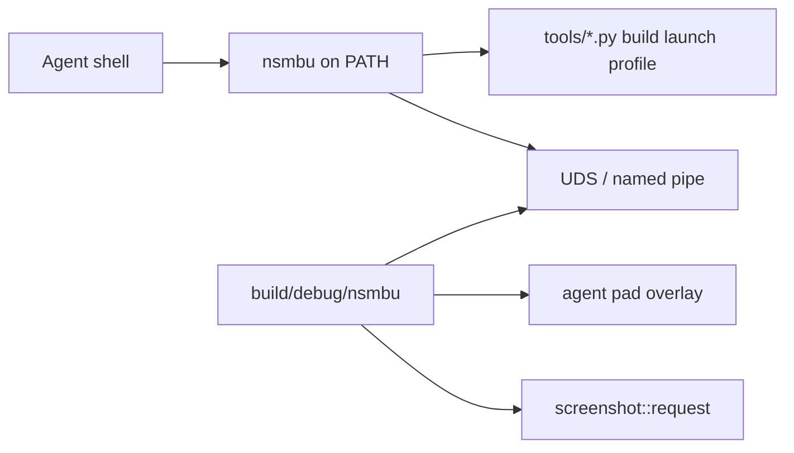

# `nsmbu` developer and agent CLI

## Goals

Ship a native TypeScript CLI under `tools/cli/` run with Node 24 type stripping (`node …/*.ts`, erasable TypeScript only; `tsc --noEmit` for checks).
Expose it globally as `nsmbu` via `npm link` from `tools/cli/`.
Agents and automation always invoke `nsmbu …` on `PATH`.
Game regressions belong in `nsmbu test` playtest cases (see [automation.md](automation.md)).
Short live control (`status`, `press`, `stick`, `screenshot`, `wait`, `quit`) is for a look while writing a case.
Course pad logs live under `tools/cli/src/playtest/replays/` and run as `nsmbu test replay-1-1` and `replay-2-1`.
`replay-bug-1` checks the intro-skip quit.

Only one game instance is supported.
The process is too heavy to run more than one, so there is no `--session` flag and no multi-instance control.

## Install

Node 24 or newer.

```
cd tools/cli && npm link
```

After that, use the global `nsmbu` on `PATH`.
Do not invoke `node tools/cli/bin/nsmbu.ts` or a repo-root shim.

### Fish completions

```
nsmbu completion fish --install
```

That writes `~/.config/fish/completions/nsmbu.fish`.
New fish sessions load it automatically.
In an already-open shell, run `source ~/.config/fish/completions/nsmbu.fish`.
To print the script instead of installing: `nsmbu completion fish`.

## Architecture



### Transport

Unix domain socket on Linux and macOS; named pipe on Windows.
Fixed path under `.tmp/agent/` (socket, pid, optional log) for the single running instance.
The game opens the listener when started through `nsmbu open` (or `launch --agent`).
Protocol: newline-delimited JSON request/response.
No HTTP server.

### Input model

Live pad overlay merged in `input::read()` in `runtime/src/platform/input_sdl.cpp` (same layering idea as `mods::pad_inject`).
Hold bits or stick axes until released or until a short pulse duration (default about 20 frames).
Does not write replay files.
Course recordings are the `replay-*` playtests.

### Observation

Commands call into existing APIs: `render::frame_count()`, `interp::logic_steps()`, optional `interp::player_snapshot()`, `screenshot::request()` / dump path under `.tmp/agent/`.

## Dev commands

Package name and binary name are `nsmbu`.
Entry: `tools/cli/bin/nsmbu.ts` with shebang / `package.json` `"bin":{"nsmbu":"…"}`, `"type":"module"`, `"engines":{"node":">=24"}`.

The CLI exports `NSMBU_CLI=1` and `NSMBU_USER_DIR=<repo>/nsmbu` on every dev command (same layout as before).

| Command | Role |
| --- | --- |
| `nsmbu build` / `build --release` / `build --sanitizer` | `tools/build/build.py` |
| `nsmbu launch` (+ `--no-debug`, `--trace`, `--gdb`, `--lldb`) | `tools/run/launch.py` |
| `nsmbu crash` | launch with `NSMBU_TEST_HOST_CRASH=1`; in a Debug build the process exits non-zero and prints the crash log path instead of the Report crash dialog |
| `nsmbu wine` (+ `--no-debug`, `--trace`) | cross-build `build/windows/nsmbu.exe` then `tools/run/launch.py --wine` |
| `nsmbu run` / `run --release` | build then launch |
| `nsmbu extract` | `tools/disc/extract.py` |
| `nsmbu save <save.dat\|save.json> [output] [--output PATH]` | convert `rp_savedata.dat` to JSON and back |
| `nsmbu profile` / `perf` | profiling helpers |
| `nsmbu installer [--version VERSION] [--no-open]` | builds this Linux host's GitHub Release folder (the zip contents) at `build/installer` with the pinned zig toolchain, SDL3, and Vulkan-Headers from the tree, then opens that folder's setup window; `--no-open` returns after the package is ready; does not publish |
| `nsmbu apk` | builds the same setup APK as a release: Python, the compiler and the extractor are inside, and the game code is not. Installs it on a USB device (`adb`). `--build-only` skips adb. `--install-only` installs the last APK. |
| `nsmbu recomp` | Recomp only |
| `nsmbu scripted <name>` | wraps `tools/run/scripted-run.sh` |
| `nsmbu test [--list] [--show] [name…]` | boots a game per playtest and runs selected cases in parallel ([automation.md](automation.md)); `--show` leaves the window on screen and runs one case at a time |
| `nsmbu scenario OUT [VAR=value …]` | headless logic-step trace for build-to-build comparison ([automation.md](automation.md)) |
| `nsmbu compare-runs RUN_A RUN_B [--scene NAME] [--steps N]` | diff two `scenario` output folders ([automation.md](automation.md)) |
| `nsmbu bench [--list] [name…]` | opens one visible game and records a render trace for a performance scenario ([automation.md](automation.md)); only `--list` is a valid flag |

Run `nsmbu` with no arguments (or `--help`) for the full list.

### Save data

`nsmbu save` converts `rp_savedata.dat` to JSON and back.
Pass the save file to produce JSON next to it; pass the JSON to produce a `.dat` file.

```
nsmbu save .tmp/menutr2/save/common/rp_savedata.dat
nsmbu save .tmp/menutr2/save/common/rp_savedata.json
nsmbu save in.dat out.json
```

The JSON keeps every unknown and padding byte.
Challenge `replayCrc` values in JSON are read for inspection only; they are recomputed when writing the `.dat` file.
No block CRC32 fields appear in the JSON; those trailers are recomputed when writing the `.dat` file so the game still accepts it.
Non-finite `f32` values (star coin coordinates) are written as `0x`-prefixed 32-bit hex.

## Compile

Generated C uses `musttail`, so the build uses Clang.
On Linux, `tools/build/build.py` adds the `libstdc++` path when it finds `libstdc++.so` under `/usr/lib/gcc/`.

`nsmbu build` runs the recompiler when `game/code/red-pro2.rpx` is newer than `build/gen`.
It also runs the recompiler when the contents of `hooks.txt` or a `hooks_*.txt` file change.
When that RPX is absent, the build fills `build/gen` with `recomp/stubgen.py` so the tree still links.

Set `NSMBU_VERBOSE_BUILD=1` to print full CMake configure output (pkg-config checks and other `--` status lines).

An RPX from a disc that lacks the 1.3.0 update has different addresses.
Those addresses miss `references/headers` and `recomp/headers_names.txt`.

A warm `nsmbu build` skips `cmake -S` when the build cache already matches the compiler flags and CMake options.
Regenerate guest stubs only when `hooks.txt`, `hooks_*.txt`, or the recomp inputs changed.
The `0 hooks` line from stub generation is normal.
Hooks live in `build/gen`.
`recomp/guest_stubs.py` writes weak stubs for guest symbols the runtime still names.
CMake runs that script on every build.
A generated game function with the same name replaces the stub.

## Launch

`nsmbu launch` sets `NSMBU_PROFILE`, `NSMBU_VK_STATS`, and `NSMBU_SYNC_STATS` when those variables are unset.
It does not set `NSMBU_CRASH_RECOVERY`.
`nsmbu launch --no-debug` and `nsmbu run --release` leave those variables unset.

## Python helpers (no `nsmbu` subcommand)

These stay as `python3 tools/…` until they move into the CLI.

| Script | Role |
| --- | --- |
| `recomp/analyze.py` | Find branch islands in recomp output ([vendor/decomp/docs/decomp-notes.md](../../vendor/decomp/docs/decomp-notes.md)) |
| `tools/rpx/ppcdis.py` | Disassemble guest `.text` (see `vendor/decomp/docs/TODO.md`) |
| `tools/frames/flicker.py` | Compare frame dumps ([automation.md](automation.md)) |
| `tools/bench/bench_lib.py` | Save-state A/B statistics (unit tests; scenarios use `nsmbu bench`) |
| `tools/shader/shaderprep.py` | Metal shader head-start cache |

## Host tests

Host tests are CTest targets in `tests/CMakeLists.txt`.

```bash
ctest --test-dir build --output-on-failure
```

Linux CI also runs the Python tests after that `ctest`.

```bash
python3 -m unittest discover -s tests/py -p "test_*.py"
```

`.githooks/pre_push.py` runs before a push when `core.hooksPath` is `.githooks`.
The script builds the commit you push.
It then runs `ctest`, `python3 -m unittest discover -s tests/py -p "test_*.py"`, and `npm test --prefix tools/cli`.

Profiling follows [performance.md](performance.md).

## Local userdata

The `nsmbu` CLI points `NSMBU_USER_DIR` at the gitignored `nsmbu/` folder on dev commands.
A portable release uses the same layout under `data/nsmbu/` when `portable.txt` sits next to the binary.

The run log is `nsmbu/logs/nsmbu.log`.
`nsmbu/mods.json` stores the enabled mods and their options.

## Live look

Commands talk to the single running game over the fixed control socket.
Use them for a short look while writing a playtest case; lasting coverage stays in `tools/cli/src/playtest/cases/` and `nsmbu test`.

- `nsmbu open [slot|course|course-file] […]` — ensure a debug binary, spawn the game with agent control enabled, wait until the socket accepts.
  Release builds ignore `NSMBU_AGENT_SOCK`.
  A course file is a `course_res_pack` archive, such as `game/content/Common/course_res_pack/1-27.szs`, and starts that course the same way as `1-27`.
  Refuse if a game is already running.
- `nsmbu status` — one line from the guest thread: frame, logic step, pid, scene name, whether the world map or a course task is alive, course pack, entering pack when it differs, save file, map checkpoint, map node and world, and the player snapshot or `player=none`.
  On the world map the line also has the node name, the node position, and the map player position.
  `area=1` means a course area is running.
  Fields that are not ready are omitted.
- `nsmbu leave` — quit the live course through `requestCourseOut_Normal` on the guest thread.
  The command returns an error when no course is running.
- `nsmbu press A` / `press 8000` — short pulse (configurable frames).
- `nsmbu stick <x> <y> [--frames N]` / `rstick …`
- `nsmbu screenshot [path]` — wait until PNG written; print path.
- `nsmbu wait --frame N` / `wait --step N` / `wait --scene NAME` / `wait --cursor NAME` — poll until every bound is met.
  `--scene` matches the scene name (`Boot`, `Flow`, `FileSelect`, `SaveSelect`, `Title`, `Menu`, `Map`, `CourseTask`, `CourseSelect`).
  `--cursor` matches the selected world-map menu button name, such as `Settings`.
  A timeout includes the last status line.
- `nsmbu goto <title|file|map|W-C>` — ask the guest thread to open that place, then wait until status shows it.
  `map` opens the first save on the world map.
  `1-1` is a course pack.
- `nsmbu ui` — settings overlay open flag and tab, and the world-map start menu cursor, button names, and rectangles.
- `nsmbu actors [--limit N] [--radius N]` — the player power-up, then the nearest course actors with profile id, position, and velocity.
- `nsmbu log [--tag a,b] [--lines N]` — recent lines from the in-process log ring.
  `--tag menu,scene` keeps lines that contain `[menu]` or `[scene]`.
- `nsmbu picture [--frames N] [--rect x,y,w,h]` — capture a few TV frames and print a hash plus the mean and max channel change inside the rectangle.
  The rectangle is in 1280×720 TV pixels.
  Omit it to use the whole frame.
- `nsmbu restart` — remember the course pack, world map, title, or file select, quit, rebuild `build/debug/nsmbu` when a runtime source is newer, then open that place again.
- `nsmbu quit` / `close` — graceful quit and tear down control files under `.tmp/agent/`.

These commands block until their work is done: `open` waits for the socket, `leave` waits for the guest thread to quit the course, `press` / `stick` hold for their frames, `screenshot` and `picture` wait for the PNGs, `status`, `ui`, and `actors` wait for the guest thread, `goto` waits until that place is current, and `wait` polls until the frame, step, scene, or cursor bound.
Use `wait --step N` or `wait --scene NAME` when the next action needs guest progress.
`nsmbu scripted <name>` remains for exit-at-frame dumps (see [automation.md](automation.md)).

## Runtime work

New small module (for example `runtime/src/agent/agent_ctl.cpp` and header):

- Start listener when `NSMBU_AGENT_SOCK` (or equivalent `env::` entry in `runtime/src/core/env.h`) is set by the CLI.
- Accept one local client connection at a time (or multiplex simple request IDs).
- Apply pad overlay each `input::read()`.
- Service screenshot and quit on the render/host thread safely (queue commands, apply on known threads — same discipline as overlay / `hostui::post`).
- Service `status` on the guest thread next to `mods::packages::frame()`, so reads see game state at the same point as mods.
  `status` also runs on a held frame so a stuck logic step still answers.
  Playtest `Session` helpers that change scenes use that same guest-thread path.
- Wire quit to the existing SDL quit path.

No change to the replay file format or `NSMBU_PRESS` start-only tables except coexistence (agent overlay OR’ed with scripted/replay as documented).

## Docs and agent skills

`CONTRIBUTING.md`, `docs/developer/nsmbu/port.md`, `docs/developer/automation.md`, and `AGENTS.md` use `nsmbu …` for CLI invocations.
`.agents/skills/nsmbu/SKILL.md` steers agents to playtest cases first, with live look commands for short checks.
Complex input stays on `record` / `replay`.

## Implementation notes

The CLI shells out to existing Python tools for build, launch, and profile; do not reimplement CMake in TypeScript.
TypeScript: erasable syntax only (`erasableSyntaxOnly` in `tools/cli/tsconfig.json`); imports use `.ts` extensions.
Control state for the one instance lives under `.tmp/agent/` (gitignored via existing `.tmp/`).
Global install is `npm link` from `tools/cli/`; do not add a repo-root wrapper script.
No `--session` and no multi-game support.
