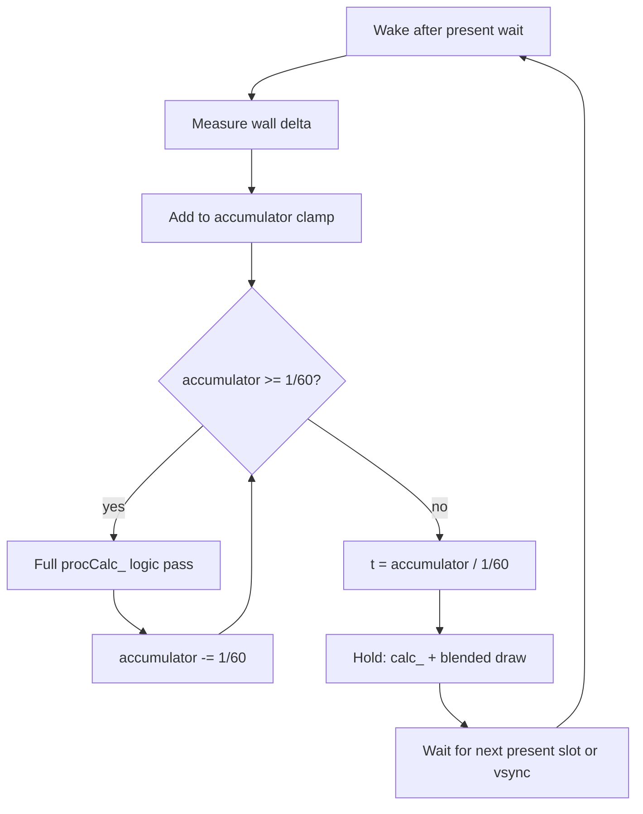

# Delta-time frame rate (replace discrete FPS ladder)

## Goal

Keep guest logic at a fixed 60 steps/s, and drive how many draws happen between those steps from wall-clock time instead of the current discrete FPS ladder and per-rate special cases.

Out of scope: scaling physics, collisions, or `FrameCtrl` by a variable delta.
The game is authored for one sixtieth of a second per logic step ([vendor/decomp/docs/frame-loop.md](../../vendor/decomp/docs/frame-loop.md)).

## Why the current path feels hacky

Today [runtime/src/hooks/interp.cpp](../../runtime/src/hooks/interp.cpp) + [interp_pacing.h](../../runtime/src/hooks/interp_pacing.h) + GX2 wait code:

- Snap the user choice to `{60, 120, 144, 165, 240}`.
- Plan `frames_for_step` with integer Bresenham (`rate * (step+1)/60 - rate * step/60`).
- Pace holds with a fixed `16.666667 ms` logic slot, hold averages, and `plan_in_between` / `next_pass` drop/record heuristics.
- Special-case rates where `fps % 60 != 0` (`output_slot_ns`, `absorb_late_wake`, vsync period `1e9/fps`).
- Split a 60 Hz vsync into quarter granules (`vsync_granule`) so 120/240 can wake mid-interval.
- Derive blend `t` from present index vs logic step (`even_fraction`), not from time left in the open step.

That works, but every new refresh rate or late-frame bug needs another branch (see CHANGELOG entries for 120/144/165).

## Target model

Fixed-step sim + variable present rate (classic "spiral of death"–safe accumulator):

```text
const step = 1/60 s
accumulator += wall_delta   # clamped
while accumulator >= step:
    run one guest logic pass (full procCalc_)
    accumulator -= step
t = accumulator / step      # in [0, 1) for blend
present one interpolated frame (hold path: calc_ + draw)
sleep / vsync until next present opportunity
```

User "frame rate" becomes a **present cap** (and optionally uncapped), not a planner that invents N discrete substeps per logic step.



## Mapping onto the existing hooks

Keep the current hook sites; change their scheduling policy.

| Piece | Keep | Change |
| --- | --- | --- |
| `hook_029C52CC` | Full logic vs hold branch; call `f_029C52CC_orig` or `f_029C5104` | Decide logic vs hold from accumulator, not `plan_step` / `g_hold_next` phase counters |
| `hook_029C4FE4` | Skip draw on map holds; course blend draws | Same gates; fire once per present |
| Camera / `ModelG3d::calcGPU` blend | Lerp with `pass_t()` | Set `pass_t()` from `accumulator / step` |
| GX2 wait / swap interval | Present pacing | Wait for `min(display period, 1/cap_fps)`; drop quarter-granule / per-ladder slot math where possible |
| Overlay rates | Still show 60 / 120 / … | Treat as present caps; allow "display" / custom later |

Do not use guest `mCalcPassCount` for high FPS.
That field multiplies **logic** trees in one `procCalc_`, which would speed the game up.
Use it only if a future "catch-up" path needs multiple logic steps in one host wake (same as the accumulator `while` loop, but still one authored step each time).

## Implementation phases

### 1. Decomp / names (done / ongoing)

- Document sead + `ApplicationFramework` loop in [vendor/decomp/docs/frame-loop.md](../../vendor/decomp/docs/frame-loop.md).
- Name `mCalcPassCount` / `mSkippedCalcCount` in decomp headers.
- Optional later: name `sead::GameFrameworkCafe::procFrame_` / `waitForNextFrame_` in `headers_names.txt` once addresses are pinned from a `references/sead` + headers pass.

### 2. Host clock accumulator (core)

In `interp` (new small module or rewrite of the paced block in `interp.cpp`):

- `step_ns = 1e9/60`.
- On each framework entry (or each present wake): `now`, `dt = now - last`, clamp `dt` (e.g. 0…100 ms) so a hitch does not run dozens of logic steps.
- `acc += dt`; while `acc >= step_ns` run one logic pass and `acc -= step_ns` (cap steps per wake, e.g. 4, then leftover stays for slow-mo under load — matches "Keep game speed" intent).
- Else run one hold pass with `t = acc / step_ns`.
- Present once per wake; do not invent N holds up front.

Unit-test the accumulator in `runtime/test/` (pure timing math, no GPU): hitch clamp, multi-step catch-up, `t` monotonic in a step, present-cap spacing.

### 3. Simplify GX2 pacing

In [gx2_core.cpp](../../runtime/src/gx2/gx2_core.cpp):

- Prefer one present-period wait derived from `min(display_hz, present_cap)`.
- Retire or narrow `vsync_granule` quartering, `output_slot_ns` for 144/165, and `absorb_late_wake` once the accumulator owns late frames.
- Keep uncapped debug path as "no present wait; still advance guest time for 60 logic/s" or document if uncapped stays "run as fast as possible" for benches.

### 4. UI / env

- Frame menu: keep labeled caps; wire them to `present_cap` instead of `interp::set_fps` ladder semantics.
- `NSMBU_INTERP_FPS` sets the present cap.
  `NSMBU_INTERP=0` turns interpolation off for that start: one present per logic step, paced at 60 when the chosen rate is above 60.
  The 30 fps preset still runs two logic steps per picture.
- Hotkeys 6/7/9 stay; behavior description in overlay help updates to "present cap".

### 5. Regression

Playtests / benches that already care about interp:

- World-map shadow flicker at high present rates ([map-shadow-interp.md](../../vendor/decomp/docs/map-shadow-interp.md)): outside a course, skip `procDraw_` on the present that follows a hold calc.
- Course enter at high rate (CHANGELOG crash fix): no extra logic from holds.
- Logic steps/s ≈ 60 with present caps 120/144/165/240 on a fast machine.
- `nsmbu replay --release 1-1` or existing interp pacing unit tests rewritten for accumulator.

Add a small playtest that asserts logic rate stays near 60 while present rate tracks the cap (reuse status `step` / overlay counters via scripted session if already available).

## Non-goals

- True variable-timestep gameplay (changing gravity, jump height, `FrameCtrl` rates by `dt`).
- Arbitrary Hz guest logic (e.g. 120 Hz sim).
- Matching Cemu frame pacing bit-for-bit.

## Success criteria

- One scheduling story for all present caps (no `% 60` / 144/165 forks).
- Blend `t` comes from time remaining in the open 60 Hz step.
- Logic steps/s stays ~60 when the machine keeps up; under load, presents drop before logic races (clamp + step cap).
- Overlay and CHANGELOG can describe "present rate" without listing per-rate wait bugs.
