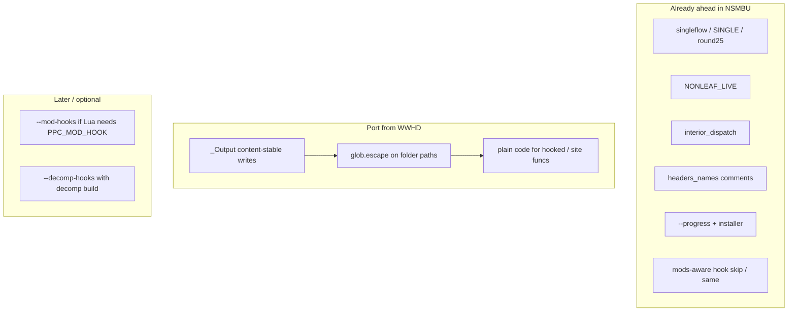

# Port WWHD recomp.py improvements

Source of truth: [`vendor/ZeldaWWHDRecomp/tools/recomp/`](../../vendor/ZeldaWWHDRecomp/tools/recomp/) (commit `f0e6fcb7` and neighbours).
If a fresher checkout exists under [`.tmp/ZeldaWWHDRecomp`](../../.tmp/ZeldaWWHDRecomp), diff it before implementing and prefer the newer behaviour when it still applies.

Target: [`tools/recomp/recomp.py`](../../tools/recomp/recomp.py) and the small helpers that touch the same output tree (`stubgen.py`, `builds.py`, `guest_stubs.py`, installer globs).

Keep NSMBU-only behaviour.
Do not replace this tree with a wholesale copy of WWHD's recompiler.

Delivery: one commit per package below (message + Unreleased changelog line each).
Later packages depend on earlier ones as noted.

## Keep (do not regress)

NSMBU already diverged ahead of WWHD in several places.
Leave these alone unless a WWHD fix is specifically about them:

- Floating-point passes: `NSMBU_RECOMP_SINGLE`, `NSMBU_RECOMP_SINGLE_IP`, [`singleflow.py`](../../tools/recomp/singleflow.py), `find_saved_clobbers`, `round25` elision in [`ppc2c.py`](../../tools/recomp/ppc2c.py).
- [`leaflocal.py`](../../tools/recomp/leaflocal.py) live-only reloads (`NSMBU_RECOMP_NONLEAF_LIVE`) and [`test_leaflocal.py`](../../tools/recomp/test_leaflocal.py).
- Jump-table interior dispatch (`_build_interior_dispatch`, `extra_dispatch_addrs` in `table.c`).
- Canonical naming for pack-inserted functions (`sym()` with bit 31) and callee / `funcs.h` names from [`names.py`](../../tools/recomp/names.py) / `headers_names.txt`.
- Installer progress (`--progress`, `on_progress`).
- Regional / pack hook policy in [`builds.py`](../../tools/recomp/builds.py) (`differing_hook`, `same`, skip outside text for non-mod builds).
- Direct `hook_XXXXXXXX(c)` / `site_XXXXXXXX(c)` calls (WWHD uses `ppc_host_call`; keep NSMBU's form).
- Env prefix `NSMBU_RECOMP_*` (do not rename to `WWHD_RECOMP_*`).
- Stale `code_*.c` deletion after a shorter run (NSMBU already removes files not rewritten).

## Out of scope

- Game-specific hook lists from WWHD (`hooks_gyro.txt`, `hooks_climb.txt`, mod-stages, …).
- Guest-mod ABI / `guest_mods.cpp` / native SDK (Lua path owns mods; see [lua-mods.md](../modding/lua-mods.md)).
- Full decomp-build pipeline (`tools/decomp_build/`, `WWHD_DECOMP`) until NSMBU has its own decomp product path.
- Multithreading the recompiler ([TODO](../TODO.md)); WWHD does not have this either.
- Porting WWHD's simpler `sym()` / dropping interior dispatch / dropping singleflow to "match" WWHD.

## Commit sequence

### 1. Escape folder paths in globs

WWHD commit `a70ac08c`: paths with `[…]` broke `glob.glob` (character classes).

- Port `glob.escape` on the **directory** part only in:
  - [`tools/recomp/builds.py`](../../tools/recomp/builds.py) (`all_builds`, `hook_files`)
  - [`tools/recomp/stubgen.py`](../../tools/recomp/stubgen.py) (hooks + runtime scan)
  - [`tools/recomp/guest_stubs.py`](../../tools/recomp/guest_stubs.py) (runtime scan)
  - [`tools/installer/setup.py`](../../tools/installer/setup.py) (`code_*.c` counts / lists)
- Add a small regression (bracketed temp dir) next to existing setup / builds tests.
- Tests: extend `test_setup` / `test_builds` as WWHD did.

### 2. Content-stable recomp output (`_Output`)

WWHD commit `f0e6fcb7`: rewriting every `code_*.c` / header on each run forced a full guest rebuild even when text was identical.

- Port `_Output` (`io.StringIO` that writes only when content differs) from WWHD [`recomp.py`](../../vendor/ZeldaWWHDRecomp/tools/recomp/recomp.py).
- Use it for `code_NNN.c`, `funcs.h`, `table.c`, `imports.c`, `imports.json`, `report.txt`.
- Keep NSMBU's stale-file cleanup: unlink `code_*.c` names not produced this run (so a shorter translation still shrinks the tree and dirties the build correctly).
- Keep `--progress` reporting; do not require WWHD's quieter CLI.
- After change: `nsmbu game usa-1.3.0 --recomp` twice in a row must leave mtimes of unchanged files alone (or equal content + no rewrite).

### 3. No-op build check

Deferred: NSMBU does not ship `check_noop_build.py`.
Use a second `nsmbu build` locally when debugging unnecessary rebuilds.

### 4. Plain code for hooked and site functions

WWHD (`4af135fc` / current `emit_function`): skip crlive + leaflocal when the function is a port hook, contains `@ADDR` sites, or (later) is built with `--mod-hooks`.
Outside code (`hook_X`, `site_X`, mods) reads and writes the `Cpu` mid-function, so locals / dropped CR bits are wrong there.

Today NSMBU always runs CRLIVE, and only skips LEAF for hooked/site and NONLEAF for hooked.

- Introduce a `plain` flag matching WWHD: `hooked or any(site in body) [or mod_hooks]`.
- Gate CRLIVE, LEAF, and NONLEAF on `not plain` (keep `NSMBU_RECOMP_CR_CHECK` behaviour for checking builds aligned with WWHD's `elif CR_CHECK` path where practical).
- Do not change site emission style (`site_X(c)` vs folding into nonleaf strings); keep NSMBU's current site wiring inside the non-plain path.
- **Requires** `nsmbu game usa-1.3.0 --recomp` then `nsmbu build` and a focused `nsmbu test` set that hits hooked functions (interp, aspect, saves, …).
- Diff `build/gen` only for hooked / site-bearing functions; leave singleflow output alone.

### 5. Optional: `--mod-hooks` for a future Lua dispatcher

Documented as removed for guest mods in [lua-mods.md](../modding/lua-mods.md).
Reintroduce only if Lua needs a per-function flag check in generated code.

- Port CLI `--mod-hooks` / `NSMBU_RECOMP_MOD_HOOKS=1`.
- Emit `PPC_MOD_HOOK(ordinal, addr)` after `PPC_ENTER` (needs the runtime macro + registration again, or a Lua-shaped equivalent).
- Force `plain` for the whole translation when enabled; disable `PPC_GQR_STATIC_FLOAT` as WWHD does.
- Do **not** bring back `guest_mods.cpp` wholesale; only the recomp emission + whatever thin registrar Lua requires.
- Stubgen / table registration only if the runtime side lands in the same change.

### 6. Optional: `--decomp-hooks` with an NSMBU decomp build

Port only together with a real decomp product (WWHD: `tools/decomp_build/gen.py`, CMake `WWHD_DECOMP`).

- `--decomp-hooks FILE`, `_decomp_hooks`, `write_decomp`, copy `decomp_hooks.txt` into `OUTDIR`.
- USA-only; refuse non-canonical builds.
- Keep listed+site / non-entry functions as `decomp_kept` with `g_recomp_decomp_kept`.
- Mirror stubgen support from WWHD [`stubgen.py`](../../vendor/ZeldaWWHDRecomp/tools/recomp/stubgen.py).

## Verify

For packages 1–3 (no codegen policy change):

- Unit tests for globs / noop checker.
- Double recomp: second run writes nothing; `ninja -d explain` after a settled build shows only always-on steps.

For package 4 (and 5–6 if taken):

- Full `--recomp` + `nsmbu build`.
- `nsmbu test` cases that exercise hooks (interp / aspect / save / course load as applicable).
- Spot-check `report.txt` leaf/nonleaf/CR counts still make sense with plain functions excluded.

## Notes for implementers

- Prefer copy-then-adapt from `vendor/ZeldaWWHDRecomp`, then rename env vars and call sites; do not reimplement `_Output` from scratch.
- Never drop NSMBU's singleflow / interior dispatch / names / progress to make the file look like WWHD.
- Android on-device setup ([android-wwhd-port.md](android-wwhd-port.md)) already assumes embedding `recomp.py` with a 4-arg argv and no `--mod-hooks` unless `NSMBU_RECOMP_MOD_HOOKS`; keep that contract when adding flags.
- Changelog: player-facing only when rebuild time or hook correctness visibly changes; otherwise a short Unreleased tools line is enough.
