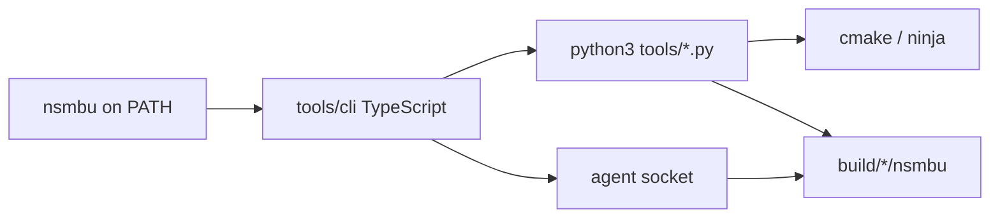

# Port Python tools into the TypeScript CLI

Goal: replace every `tools/**/*.py` script with TypeScript under `tools/cli/`, so `nsmbu` owns the whole developer, agent, installer, recomp, and release surface, and the repo no longer needs Python on the PATH for day-to-day work.

Today the CLI is already TypeScript (`tools/cli/`, Node 24 type stripping, `npm link` → global `nsmbu`).
Most commands still shell out to `python3` via `tools/cli/src/run.ts` and `dev.ts`.
This document is the inventory, constraints, target layout, and phased work to finish that move.

## Current state



After the port, TypeScript calls cmake, ninja, the game binary, and native helpers directly.
Python is gone from CI, CMake custom commands, release packaging, and the Windows embeddable runtime that ships with the installer.

Rough size today (line counts, including tests):

| Area | LOC | Files |
| --- | ---: | ---: |
| `tools/recomp/` | ~3400 | recompiler, PPC→C, builds, names, tests |
| `tools/installer/` | ~2800 | `setup.py` (~2200) plus `dev_pkg` / tests |
| Dev wrappers (`build`, `launch`, `extract`, `slot`, …) | ~900 | CLI already wraps most of these |
| `tools/release/` | ~1000 | package, guard, notes, AppImage |
| Misc (`shaderprep`, `wudextract`, `bench`, `perf`, …) | ~1900 | mostly not on `nsmbu` yet |
| **Total** | **~10k** | **~41 `.py` files** |

`docs/cli.md` still says the CLI should shell out to Python and not reimplement CMake in TypeScript.
That stays true for CMake itself: keep invoking `cmake` / `ninja`.
The change is to stop using Python as the orchestration language around them.

## Inventory

### Already exposed as `nsmbu` (Python behind the TypeScript facade)

| `nsmbu` command | Python today | Notes |
| --- | --- | --- |
| `build` | `tools/build.py` | Configure + build; may call `recomp.py` / `stubgen.py`; clang/`libstdc++` probe |
| `launch` / `run` / `record` / `replay` | `tools/launch.py` (+ `slot.py`, `devdata.py`) | Env, save dir, slot/course args, gdb/lldb, `execve` |
| `extract` | `tools/extract.py` → `wudextract.py`, `game_dump.py`, `recomp/builds.py` | Disc extract + update merge + SHA check |
| `profile` / `perf` | `tools/profile.py`, `tools/perf.py` | Fixed-scene profile; Linux `perf` wrapper |
| `installer` | `build.py` + `installer/dev_pkg.py` | Local release-shaped package then setup GUI |
| `recomp` | `tools/recomp/recomp.py` | RPX → `build/gen` |
| `open` (spawn path) | `launch.py` again | Agent control loop itself is already TS |

Also shell, not Python: `nsmbu scripted` → `tools/scripted-run.sh`, `nsmbu lint` → TypeScriptToLua / StyLua.

### Not on `nsmbu` yet (still direct `python3 …`)

| Script | Role |
| --- | --- |
| `tools/recomp/{analyze,ppc2c,singleflow,leaflocal,crlive,builds,names,stubgen,guest_stubs,mkbuildmap}.py` | Recomp pipeline internals and helpers |
| `tools/recomp/test_*.py`, `write_map_fixture.py` | CMake/`ctest` and CI |
| `tools/installer/setup.py` | End-user first-run setup (shipped in releases) |
| `tools/installer/test_setup.py` | CI unit tests |
| `tools/release/{package,guard,notes,appimage}.py` | Release workflow |
| `tools/release/test_sdk_package.py` | CMake test |
| `tools/bench/run_bench.py` | Renderer bench orchestration |
| `tools/shaderprep.py` | Shader cache head-start |
| `tools/wudextract.py` | Disc image reader (MPL port of Cemu WUD/FST) |
| `tools/rpx.py`, `rpxinfo.py`, `ppcdis.py` | RPX inspect / disasm |
| `tools/flicker.py` | Frame-dump flicker check ([automation.md](automation.md)) |
| `.git-hooks/pre_push.py` | Git hook helper (not under `tools/`) |
| `runtime/tools/driver_store_test.py` | CMake test wrapper |

Native C++ already covers part of extract: `nsmbu-extract` (`tools/wudextract/`).
Prefer driving that binary from TypeScript over re-porting the Python WUD reader unless behaviour still differs.

## Constraints

1. **Erasable TypeScript only** — same rules as today (`erasableSyntaxOnly`, `.ts` imports, `tsc --noEmit`, Node ≥ 24).
2. **One global binary** — keep `nsmbu` via `npm link`; no repo-root shim; agents always call `nsmbu …`.
3. **CMake stays CMake** — TypeScript configures and builds; it does not become a second build system.
4. **No game files in git or CI** — stubgen, build maps as digests/JSON, and release guard rules stay equivalent.
5. **Release packages must stay game-free** — `guard` parity is mandatory before deleting Python release tools.
6. **Installer runs on player machines** — today Windows ships embeddable CPython for `setup.py` (`package.py` + `toolchains.json`).
   Porting setup means either shipping Node with the release, bundling a Node SEA / similar, or rewriting setup as a native `nsmbu-setup` that no longer needs an interpreter.
7. **CMake custom command** — `guest_stubs.py` is invoked at build time (`CMakeLists.txt`).
   Replace with a small native tool or a `nsmbu` subcommand CMake can call without Python.
8. **Licensing** — `wudextract.py` is MPL-2.0 (Cemu port).
   Keep license headers and NOTICE obligations on any TypeScript or C++ replacement of that logic.

## Target layout

Keep the CLI package as the home for ported code.

Suggested modules (names can flex; keep erasable TS and `.ts` extensions):

```
tools/cli/
  bin/nsmbu.ts              # dispatch only
  src/
    run.ts                  # spawn helpers (no python3)
    dev/                    # build, launch, extract, profile, perf, scripted
    recomp/                 # RPX parse, analyze, ppc2c, recomp, builds, names, stubgen
    installer/              # setup / dev_pkg (or thin wrappers over native setup)
    release/                # package, guard, notes, appimage
    disc/                   # game_dump checks; spawn nsmbu-extract
    bench/
  test/                     # node:test (or similar) replacing unittest scripts
```

Public surface:

- Every former `python3 tools/…` entry point becomes `nsmbu <cmd>` or an internal module used by those commands.
- CI and docs call `nsmbu …` only (except where CMake must run a small helper binary).
- Shared libraries (`builds`, `slot`, `game_dump`, RPX parsing) live once under `src/` and are imported by commands and tests.

## Phased plan

Port in dependency order.
Each wave ends when CI and `nsmbu` no longer call that wave’s Python, and behaviour matches the old scripts on the same fixtures.

### Wave 0 — Scaffolding

- Drop `runPython` / `spawnPython` once callers are gone; keep generic `spawn` / `spawnSync`.
- Add a test runner in `tools/cli` (`node --test` is enough).
- Document the port in [cli.md](cli.md) (replace the “shells out to Python” note with a pointer here until the port is done).
- Decide the **installer runtime** story early (Node in the package vs native-only setup), because it blocks Wave 5 and release.yml.

**Done when:** new TS modules can be unit-tested without Python; decision recorded in this doc or cli.md.

### Wave 1 — Dev orchestration (high leverage, small code)

Port `slot.py`, `devdata.py`, `launch.py`, `build.py`, `profile.py`, `perf.py`.

- `build`: ensure-gen (recomp or stubgen), cmake configure, ninja/`cmake --build`, compile_commands symlink, clang/`libstdc++` discovery.
- `launch`: resolve exe, apply slot/course, example-mod symlinks, debug env defaults, gdb/lldb, `exec`/`spawn` of the game.
- Keep calling Python **only** for recomp/stubgen until Wave 3.

**Done when:** `nsmbu build|launch|run|record|replay|profile|perf` never start `python3` except for recomp/stubgen; slot tests ported.

### Wave 2 — Extract and disc helpers

Port `game_dump.py`, `extract.py`, and either delete `wudextract.py` in favour of `nsmbu-extract` or port the remaining behaviour.

- Wire `nsmbu extract` to the C++ extractor + TS layout/SHA checks against `builds` JSON.
- Port `flicker.py` as `nsmbu flicker` (or fold into `scripted` docs).
- Optionally port `shaderprep.py`, `rpxinfo` / `ppcdis` as `nsmbu` subcommands when needed.

**Done when:** `nsmbu extract` matches current checks on a real dump; CI/docs no longer mention `wudextract.py` for the happy path.

### Wave 3 — Recompiler

Largest correctness surface: `rpx.py`, `analyze.py`, `ppc2c.py`, `singleflow.py`, `leaflocal.py`, `crlive.py`, `recomp.py`, `stubgen.py`, `guest_stubs.py`, `builds.py`, `names.py`, `mkbuildmap.py`.

- Preserve USA-canonical addresses, build maps under `tools/recomp/builds/*.json`, and `headers_names.txt` flow ([names.md](names.md), [builds.md](builds.md)).
- Golden-test: same RPX → same `build/gen` tree (or stable diff) as the Python recomp before switching `nsmbu build` / `nsmbu recomp`.
- Replace CMake `guest_stubs.py` custom command with `nsmbu recomp guest-stubs` or a tiny native tool.
- Port `test_builds.py`, `test_coverage.py`, `write_map_fixture.py` to the CLI test suite / ctest wrappers.

**Done when:** CI stubgen + local recomp use TS only; `find_package(Python3)` can leave `CMakeLists.txt` for this path.

### Wave 4 — Release tooling

Port `package.py`, `guard.py`, `notes.py`, `appimage.py`, and `test_sdk_package.py`.

- Update `.github/workflows/release.yml` (and android guard) to `nsmbu release …` equivalents.
- Keep guard failing the job on any game-derived or key material.

**Done when:** release.yml has no `python` / `python3` steps for packaging.

### Wave 5 — Installer

Port `installer/setup.py` and `dev_pkg.py` (and `test_setup.py`).

- This is the product UX for first-run dump → extract → recomp → build.
- Removing the Windows embeddable Python depends on Wave 0’s runtime choice.
- `nsmbu installer` should keep building setup targets and launching the same GUI flow.

**Done when:** release packages no longer ship `tools/python` or `setup.py`; player setup uses the new path end-to-end.

### Wave 6 — Leftovers and deletion

- `bench/run_bench.py` → `nsmbu bench` (see [performance.md](performance.md)).
- `.git-hooks/pre_push.py` → hook calling `nsmbu` or a small TS script.
- `runtime/tools/driver_store_test.py` → native or TS test driver.
- Port `scripted-run.sh` into `nsmbu scripted` if you want zero bash in the agent path (optional).
- Delete `tools/**/*.py`, drop Python from README/CI images where unused, remove `Python3` from CMake when nothing remains.

**Done when:** `git ls-files '*.py'` under `tools/` and `runtime/tools/` is empty (or only agreed exceptions), and AGENTS/skills/docs say `nsmbu` only.

## Suggested command map (new / renamed)

| Today | After |
| --- | --- |
| `python3 tools/build.py` | `nsmbu build` (implementation in TS) |
| `python3 tools/recomp/recomp.py …` | `nsmbu recomp` |
| `python3 tools/recomp/stubgen.py …` | `nsmbu recomp --stub` (or `nsmbu stubgen`) |
| `python3 tools/recomp/guest_stubs.py …` | `nsmbu recomp guest-stubs` / CMake helper |
| `python3 tools/recomp/names.py …` | `nsmbu recomp names` |
| `python3 tools/recomp/mkbuildmap.py …` | `nsmbu recomp mkbuildmap` |
| `python3 tools/release/package.py …` | `nsmbu release package` |
| `python3 tools/release/guard.py …` | `nsmbu release guard` |
| `python3 tools/installer/setup.py` | native or `nsmbu setup` inside the package |
| `python3 tools/bench/run_bench.py` | `nsmbu bench` |
| `python3 tools/flicker.py …` | `nsmbu flicker` |
| `python3 tools/shaderprep.py …` | `nsmbu shaderprep` |

Keep flags behaviour-compatible where agents and CI already depend on them; rename only with a short deprecation or a docs sweep in the same change.

## Testing and parity

| Kind | How |
| --- | --- |
| Pure logic | Port existing unittest modules to `node --test` (builds registry, setup helpers, bench fakes, coverage audit). |
| Recomp | Byte-for-byte or structured diff of `build/gen` from a local RPX; keep map JSON fixtures committed. |
| Extract | Same SHA / title-version errors on bad layouts; success on known dumps (manual / private CI). |
| Release | `nsmbu release guard` on packaged zips; sdk package test without game files. |
| Dev loop | `nsmbu build && nsmbu launch`, `replay --release`, `open` → agent commands — smoke on a checkout with `game/`. |

Do not delete a Python module until its TS replacement is what CI and `nsmbu` invoke.

## Call sites that must move together

When a wave lands, update every caller in the same change set:

- `tools/cli/src/dev.ts` and agent spawn paths
- `CMakeLists.txt` (Python3 find_package / custom commands / tests)
- `.github/workflows/{linux,windows,android,release}.yml`
- Docs: [cli.md](cli.md), [nsmbu/port.md](nsmbu/port.md), [builds.md](builds.md), [names.md](names.md), [automation.md](automation.md), [performance.md](performance.md), README
- Skills: `.agents/skills/nsmbu`, guest/recomp skills, release skill
- Release packaging file lists (`package.py` today embeds tool paths and Windows Python)

## Out of scope / keep native

- CMake, Ninja, compilers, `perf`, AppImage tooling — still external binaries.
- Game runtime, GX2, Vulkan/Metal — stay C++.
- Prefer existing C++ (`nsmbu-extract`, `nsmbu-setup` where it already exists) over reimplementing heavy unpackers in TS.
- Vendored shader decompiler and other C++ trees — unchanged.

## Risks

| Risk | Mitigation |
| --- | --- |
| Recomp semantic drift | Golden `build/gen` before switching default path; keep Python until diff is empty |
| Installer platform matrix | Lock Wave 0 runtime choice; test macOS/Linux/Windows package layouts early |
| Windows without system Python | Today solved by embeddable CPython; Node/SEA/native setup must replace that pin |
| CMake needing an interpreter at build time | Ship a committed helper or invoke `node tools/cli/bin/nsmbu.ts` with a stable API |
| Scope creep (~10k LOC) | Ship wave-by-wave behind `nsmbu`; delete Python only per wave |

## Tracking

Work through the waves in order.
Update this file when a wave finishes (strike through or mark **done**) and when the installer runtime decision is made.

Success for the whole project: no Python dependency for build, extract, recomp, release, or setup, and agents never need `python3` for this repo.
